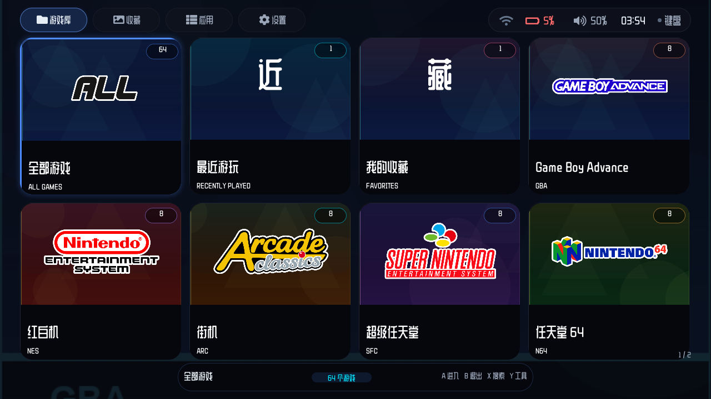
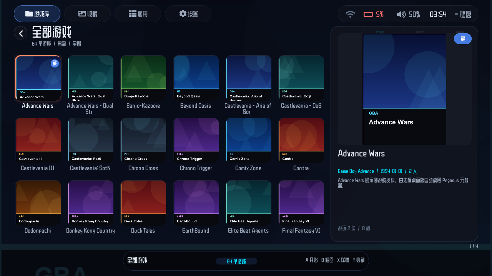
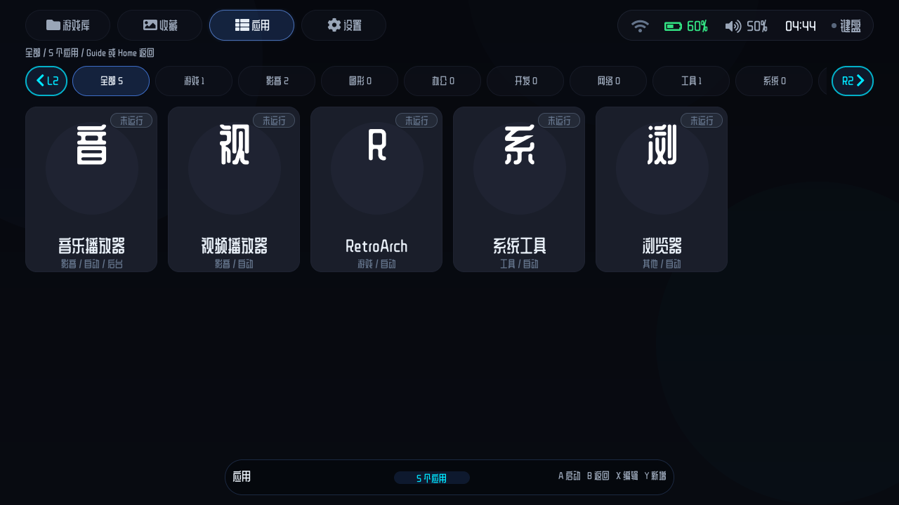
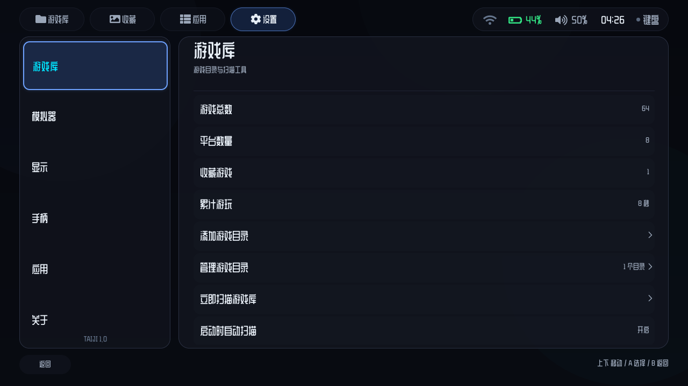
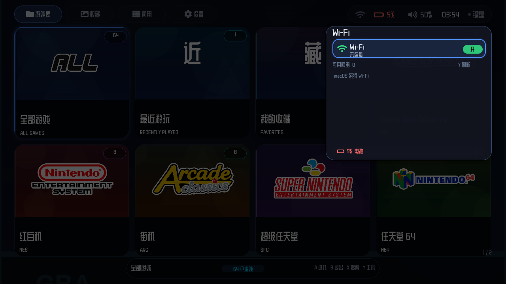
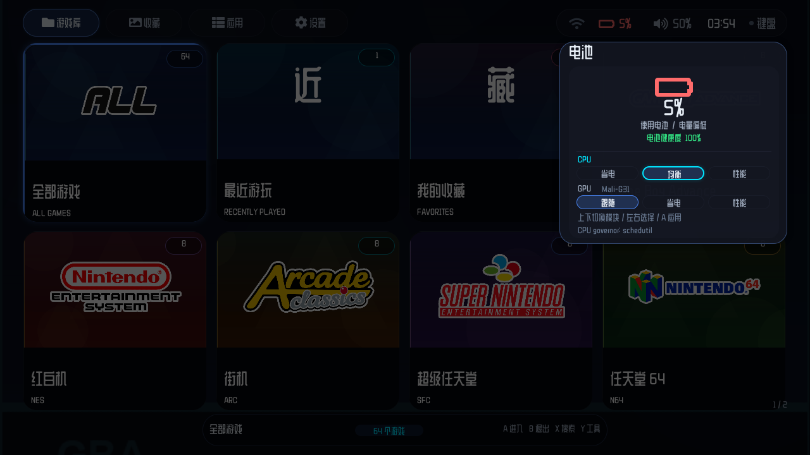
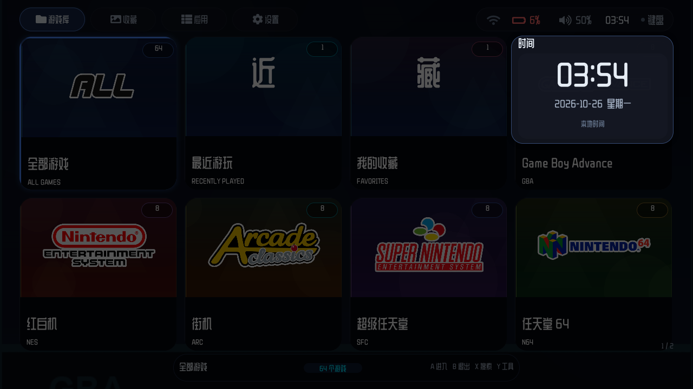
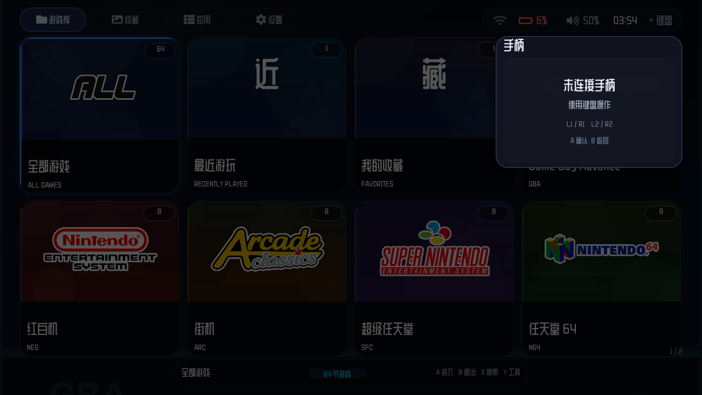

# 太极 · Taiji Desktop（LVGL + SDL2）

把 Android 版《太极 / NovaRetro》的桌面端界面与游戏库前端，用 **C11 + LVGL 9.3 + SDL2** 重写为原生 macOS / Linux 应用。


















布局是响应式的：不是把 1280×720 等比缩放，而是根据实际窗口/屏幕宽高重新计算列数、卡片尺寸、
面板宽度、页大小和字体档位，支持 4:3、3:2、16:9、21:9 等比例，窗口可以运行时自由缩放。
已验证 320×240、480×320、640×480、720×480、960×540、1024×768、1280×720、1920×1080、2560×1440（2K）。

界面沿用原版的布局语言：

- 顶部悬浮导航（游戏库 / 收藏 / 应用 / 设置）与右侧状态胶囊
- 状态胶囊显示 Wi-Fi、蓝牙、电量百分比、充电状态、音量、时间和手柄连接
- 状态栏保留一个椭圆形背景，按实际文字宽度自适应长度；内部的 Wi-Fi/蓝牙、电量、音量、时间、手柄图标可以逐个选择
- 状态栏所有文字/符号使用同一字号，高度和垂直中心统一
- 点击/触摸任意图标打开对应控制中心视图；点在图标之间的空隙也会打开最近的状态项
- 焦点统一使用主题色焦点框（普通/导航/状态栏 4px，卡片/应用图标 5px），不再用状态栏底色高亮；焦点框不会挤动图标和文字
- 顶部导航按上键不再进入状态栏，只有最右侧导航项按右才进入；状态栏按左到最左可回到导航栏
- 无侧栏页面在首行按方向键上进入顶部导航；设置/商店/文件从左侧栏首项进入，右侧内容区到顶后停住
- Linux Wi-Fi 使用 NetworkManager（`nmcli`）管理，蓝牙使用 BlueZ（`bluetoothctl`），均支持扫描、连接和开关
- 文件页支持用系统默认程序打开文件；没有关联程序时提示“未安装可用的关联程序”
- 文件页“打开方式...”按 MIME 推荐应用并显示图标；A 仅本次打开，Y 或“设为默认”按钮写入 `~/.config/mimeapps.list`
- 压缩包（7z / zip / rar / tar / gz 等）默认用 7-Zip 解压到同名目录
- 文件页可将选中文件/目录压缩为 7Z、ZIP 或 TAR，压缩与解压都在后台线程执行
- 全屏动态封面壁纸 + 环境光晕
- 首页 4×2 平台卡片网格，平台 Logo 使用原版 NeoStation 字标资源
- 底部胶囊操作栏：`A 进入 · B 退出 · X 搜索 · Y 工具`
- 游戏页左侧封面网格、右侧 PS5 风格大封面信息栏
- 设置页左侧分类栏 + 右侧可滚动详情列表（不换页）
- 状态栏控制中心卡片带发光边框和阴影
- 应用页网格为连续滚动，不按页切换
- 应用列表监听 `.desktop`、pacman 日志和同步数据库变化，有变化才刷新，不再定时扫描
- 删除 `.desktop` 或卸载应用后自动清理应用条目；手动添加的应用不受影响
- 应用列表有新增/更新且不在应用页时，顶部“应用”导航右上角显示红点，进入应用页后清除
- 应用商店卡片使用与桌面应用菜单一致的实心卡片底色，选中时显示焦点框
- 商店长菜单改为滚动，不再为了塞下所有项而缩小界面；内置/外部界面共用这套滚动与滚动条样式
- Flatpak 操作失败会给出可读原因（无网络或 DNS、权限、磁盘不足、应用或软件源不存在），不再只报退出码
- 多任务概览返回时保留进入前的页面，不再强制回首页
- 设置 → 显示 → 界面缩放：默认“自动”，手动可选 1.00 / 1.25 / 1.50 / 1.75 / 2.00 / 2.25 / 2.50 / 2.75 / 3.00
- 自动缩放按屏幕高度靠近 720p 逻辑画布取档：720p 100%、900p 125%、1080p 150%、1440p/2K 200%
- 手动选择后优先使用用户值，不再自动变化
- 文件、商店和设置页共用同一套左侧栏宽度与位置
- Wayland 下太极保持自己的界面缩放；启动外部应用时临时设置 sway output scale，回到太极后恢复，避免太极和第三方应用双倍缩放
- 第三方应用的缩放由前台切换脚本处理；X11 会话仍使用 `QT_SCALE_FACTOR`、`GDK_SCALE` / `GDK_DPI_SCALE` 和 `Xft.dpi`
- Wayland 是 SDDM 默认会话；双会话仍保留 X11 作为兼容后备
- SDDM 虚拟键盘初始隐藏，点击/聚焦密码框时显示，登录失败后自动重新显示
- 暗色深空主题、纸白主题、落日霓虹、森林复古四套配色
- 主题支持“自动（深色/浅色）”：默认跟随本地时钟，19:00–07:00 深色、07:00–19:00 浅色，深色映射深空蓝、浅色映射纸白
- 显示设置可自定义自动深色/浅色时间；留空恢复默认 19:00 / 07:00
- 设置 → 系统 提供 28 个常用时区（含 UTC）供选择，选择后立即写入系统时区
- 安装包内置 polkit 规则，允许本机活动会话直接修改时区和语言，不再弹出密码授权框
- 设置 → 系统 可切换中文 / English；切换后会同步系统语言环境、太极界面和新启动的应用，重新登录后全部应用生效

## 功能

- 扫描多个 ROM 根目录，自动识别 60+ 平台（NES / SNES / GBA / NDS / 3DS / PS1 / PS2 / PSP / MD / DC / Arcade …）
- 自动识别已安装的 RetroArch / DuckStation / PPSSPP / Dolphin / PCSX2 / melonDS / Ryujinx / MAME 等模拟器
- 读取 `metadata.pegasus.txt` 与 `gamelist.xml` 元数据
- 自动匹配封面：`media/box2dfront`、`boxart`、`covers`、`images`、`media/cover`、同名图片等
- 收藏、最近游玩、游玩次数 / 时长记录、排序（名称 / 最近 / 最多游玩 / 收藏优先）与筛选
- 为每个平台或单个游戏配置模拟器启动命令（`%ROM%` `%NAME%` `%PLATFORM%` `%DIR%` 占位符）
- 应用库：桌面式应用菜单，顶部应用分类（全部/游戏/影音/图形/办公/开发/网络/工具/系统/其他），下方可滚动图标网格
- 应用列表支持上下左右导航，上方向键从第二行回到上一行，不再只向下/左右移动
- Linux 下应用页每 10 秒自动扫描 `.desktop`，安装新应用后列表自动刷新
- 全界面按键提示按手柄自动适配：Xbox（A/B/X/Y、LB/RB、LT/RT）、PlayStation（×/○/□/△、L1/R1、L2/R2）、Switch（A/B/X/Y、L/R、ZL/ZR）；Start / Select / Guide 也按手柄显示
- 肩键 L1/R1 切换顶部栏目；应用页用 L2/R2 切换分类
- 文件页底栏只显示 A/B/X/Y 功能：Y 选中（标记）、X 打开工具菜单；侧栏里 X 打开菜单、Y 重新扫描位置
- 自动扫描 Linux `.desktop`：读取 Name / Name[zh_CN] / Exec / Icon / Categories / NoDisplay / Hidden / TryExec
- 自动按 `.desktop` 的 Categories 归类，图标自动从 hicolor/pixmaps/常见主题查找
- SVG 图标在安装了 `rsvg-convert` 或 ImageMagick 时自动转为 PNG 缓存；否则回退文字图标
- 添加任意 GUI 程序，前台独占启动，Guide/Home 返回太极并可暂停恢复
- 后台音乐：应用可标记为“继续运行”，返回太极后音乐不中断
- 单前台工作区：使用 sway 工作区，不依赖任何 X11 桌面或窗口管理器
- SDDM 多用户登录主题：用户选择、密码、自绘虚拟键盘；登录后只启动太极 Wayland 会话
- 手柄 Guide / Switch Home 通过 evdev 守护进程返回太极
- 启动游戏时最小化前端，退出模拟器后自动恢复窗口并记录本次游玩时长
- 完整手柄支持：热插拔、十字键 / 左摇杆连发、A/B/X/Y、LB/RB、LT/RT、Start/Select
- WiFi 状态、电量和电池健康度：Linux 读取 sysfs，macOS 使用 SDL 电源信息、ioreg 与 networksetup
- Linux 电池详情内提供 CPU / GPU 两个性能模块：CPU 省电/均衡/性能，GPU 跟随/省电/性能
- CPU 支持 power-profiles-daemon、platform_profile 和 cpufreq；GPU 支持 Mali/Adreno devfreq、Qualcomm KGSL、AMDGPU
- 手柄按键互换、自定义按键映射（按下即捕获）
- 鼠标点击、滚轮、键盘导航
- 系统音量通过 PipeWire `wpctl` 控制；音量键、控制卡和状态栏同步
- 长按电源键弹出电源菜单：休眠 / 重启 / 关机 / 登出
- 设置 → 显示 → SDL 渲染器显示当前实际渲染器，可选 OpenGL / OpenGL ES / VULKAN，重启生效
- 内置英文虚拟键盘，文本/搜索输入框自动弹出，可切换 Shift、数字与退格
- 虚拟键盘支持手柄：方向键移动高亮，A 输入，B 收起
- 设置 → 手柄 → 手柄按键检测：Xbox 布局图片实时高亮按下的按键
- Wi-Fi 与蓝牙列表都在后台线程异步扫描，打开控制卡不再阻塞
- UI 音效（复用原版 `taiji_*` WAV 音效）
- 鼠标指针、滚轮翻页、窗口缩放与全屏
- 启动扫描时显示太极启动画面
- 响应式布局：4:3 / 3:2 / 16:9 / 21:9，320×240 到 2560×1440
- 窗口运行时缩放会实时重建布局和字体，不需要重启

## 构建

依赖：

- CMake ≥ 3.16
- SDL2 开发包
- C11 编译器

LVGL 已经随仓库放在 `third_party/lvgl`（只保留核心源码），无需联网下载。

### macOS

```bash
brew install cmake sdl2
./scripts/build-macos.sh
open build/Taiji.app        # 脚本会生成 .app；也可以直接运行 build/taiji
```

### 安装到系统（可选）

```bash
cmake --install build --prefix "$HOME/.local"
```

会把可执行文件、资源、`.desktop` 和图标安装到 `~/.local`，之后可直接运行 `taiji`。

如果要作为显示管理器会话使用，安装到 `/usr`：

```bash
sudo cmake --install build --prefix /usr
```

会额外安装：

```text
/usr/share/wayland-sessions/taiji.desktop   Wayland 会话（sway）
/usr/libexec/taiji/taiji-wayland-session
/usr/libexec/taiji/taiji-session
/usr/libexec/taiji/taiji-run-app
/usr/libexec/taiji/taiji-return
/usr/libexec/taiji/taiji-resume
/usr/libexec/taiji/taiji-hotkeyd
/usr/share/sddm/themes/taiji/               SDDM 登录主题
/usr/share/taiji/sway.conf
```

## 作为微型桌面环境 / 显示管理器会话

太极推荐通过 **SDDM** 作为多用户 kiosk 会话运行：

- 默认且只安装 **Wayland + sway** 会话
- XWayland 为必选依赖，用于兼容纯 X11 老程序；不需要额外的 X11 桌面或窗口管理器
- 登录界面提供多用户、密码、自绘虚拟键盘、会话选择
- 官方只支持 SDDM；LightDM 不作为产品级验收目标

### 安装依赖

Debian / Ubuntu：

```bash
sudo apt install \
  build-essential cmake pkg-config libsdl2-dev \
  sddm sway xwayland \
  network-manager power-profiles-daemon pipewire wireplumber fonts-noto-cjk librsvg2-bin \
  samba avahi
```

Wi-Fi 管理需要 NetworkManager 和 `nmcli`；蓝牙管理需要 BlueZ 的 `bluetooth` 服务与 `bluetoothctl`。性能模式优先使用 `power-profiles-daemon`（`powerprofilesctl`），
没有时回退到 ACPI `platform_profile` 或 CPU `cpufreq` governor。系统音量通过 PipeWire / WirePlumber 的 `wpctl` 控制；
SDL 音频输出仍可使用 PipeWire、PulseAudio 或 ALSA dmix。
裸 ALSA 独占时，前台游戏和后台音乐不能同时出声。

### 安装

```bash
cmake -S . -B build -DCMAKE_BUILD_TYPE=Release
cmake --build build -j$(nproc)
sudo cmake --install build --prefix /usr
```

安装后在 SDDM 会话菜单选择：

```text
Taiji Wayland   ← 默认
Taiji X11       ← 兼容/救援
```

如需只发布 Wayland：

```bash
cmake -S . -B build -DTAIJI_INSTALL_X11_SESSION=OFF
```

保留 X11 源码和构建能力，不要删除 X11 代码。

### SDDM 登录主题

> 说明：QML 主题和虚拟键盘已随项目提供，但 SDDM 主题必须在目标 Linux 镜像上实机验证；
> Wayland/Mali、XWayland GLX、手柄 Guide/Home 和音频混音也属于实机验证项。


主题安装到 `/usr/share/sddm/themes/taiji`，包含：

- 多用户卡片
- 密码输入
- 自绘虚拟键盘（大小写、数字、符号、退格、空格、登录）
- 只显示太极 Wayland 会话
- 480×320 到 2560×1440 响应式布局
- 触摸与物理键盘
- 手柄映射通过 `keyd` / `uinput` 或 Qt Gamepad 完成，登录后停止

在 `/etc/sddm.conf.d/taiji.conf` 中启用：

```ini
[Theme]
Current=taiji

[Users]
DefaultSession=taiji-wayland.desktop
RememberLastSession=false
```

多用户登录场景不使用自动登录；登录界面始终显示。如果确实要自动登录：

```ini
[Autologin]
User=你的用户名
Session=taiji-wayland.desktop
```

自动登录会跳过虚拟键盘和会话选择，不建议作为默认产品配置。

### Wayland（sway）

会话脚本会：

- 启动 sway，关闭 bar、边框和间隙
- XWayland 随包安装并由 sway 自动启用
- 启动 `taiji-hotkeyd`
- 启动太极 session loop
- 使用命名工作区：`taiji` / `app` / `music`

可选后台音乐：

```bash
TAIJI_BACKGROUND_CMD="mpv --no-video /path/playlist.m3u" taiji-wayland-session
```

Wayland-only 程序不需要额外处理；X11-only 程序会自动进入 XWayland 兼容层。
XWayland 不支持真正的显示模式切换，GLX 是否硬件渲染必须用 `glxinfo -B` 验证。

### X11 兼容（仅 Xwayland）

太极安装包会安装 Xwayland，但不安装 Openbox/XFCE/GNOME 等 X11 桌面，
也不安装 X11 用户会话。SDDM 通过 Weston kiosk 承载 Wayland 登录界面，登录成功后立即退出。

纯 X11 老程序由 sway 自动交给 Xwayland 运行，没有额外的 X11 窗口管理器。

### 手柄 Guide / Home 返回

`taiji-hotkeyd` 读取 `/dev/input/event*`：

- 不 grab 设备，不影响前台应用
- 监听 `BTN_MODE`（Xbox Guide）、`KEY_HOME`（部分 Switch 驱动）和电源键
- 300ms 去抖
- 短按 Guide/Home 返回太极；长按 0.6 秒打开多任务 Overview
- 电源键长按 1.5 秒弹出电源菜单
- 用户级 systemd 服务；需要 udev `uaccess` 或 input 组权限

```bash
systemctl --user enable --now taiji-hotkeyd
```

如果前台程序 grab 了输入设备，守护进程收不到事件；sway 的 Home 快捷键是后备。

### 多任务 Overview

长按手柄 Guide/Home（约 0.6 秒）进入多任务 Overview：

- 顶部导航栏、状态栏和底栏保持可用
- 中间显示任务卡片，当前任务居中放大，左右任务缩小变暗
- 卡片顶部显示 `应用名称 (状态)`，例如 `Chromium 浏览器 (已暂停)`
- 左右键切换、A 切换到该任务、B 返回主界面
- 按 X 一次提示确认，再按一次关闭选中任务
- 启动应用前会缓存当前太极界面，作为“太极”卡片的预览图
- 进入前按会话类型截图：Wayland 用 `grim`，X11 用 `xwd`，最后回退 `/dev/fb0`
- 每次从外部应用返回太极时也会缓存一次预览
- 任务来源：
  - 太极主界面
  - 从太极启动的应用/游戏
  - 后台音乐
  - 通过 `swaymsg -t get_tree` 发现的外部 sway 窗口
- Wayland 需要 `grim`；X11 需要 `xwd`（`x11-utils`）和 ImageMagick `convert`
- `/dev/fb0` 作为最后后备，通过 udev `uaccess` 授权给当前会话用户
- Wayland 外部窗口通过 sway `con_id` 聚焦，X11 外部窗口暂不纳入

### 桌面应用导入

Linux 首次启动会自动扫描：

```text
/usr/share/applications
/usr/local/share/applications
~/.local/share/applications
~/.local/share/flatpak/exports/share/applications
/var/lib/flatpak/exports/share/applications
/var/lib/snapd/desktop/applications
```

`.desktop` 的 `Categories` 会映射到：

```text
游戏 / 影音 / 图形 / 办公 / 开发 / 网络 / 工具 / 系统 / 其他
```

图标查找顺序：

1. `Icon=` 的绝对路径
2. hicolor / Adwaita / Yaru / Breeze / Papirus 等主题的 PNG
3. `/usr/share/pixmaps`
4. SVG（需要 `rsvg-convert` 或 ImageMagick 转 PNG）
5. 文字字形回退

`librsvg2-bin`（`rsvg-convert`）用于把常见的 SVG 桌面图标转成 PNG；没有安装时只使用 PNG/文字回退。

安装新软件后，可在 `设置 → 应用 → 扫描桌面应用` 手动重新导入。
用户手动添加的应用不会被覆盖；同名 `.desktop` 导入项会更新名称、命令、图标和分类，
但保留用户设置的运行方式、返回行为和后台策略。

### 控制中心

状态栏是一个长度自适应的椭圆背景，内部有独立可选项目：

```text
( Wi-Fi | 电量 | 音量 | 时间 | 手柄 )
```

- 点击 Wi-Fi/蓝牙图标 → 网络与蓝牙控制中心
- 点击电量图标 → 电池详情 + 电池健康度；Linux 下还包含 CPU / GPU 性能模块
- 点击音量图标 → 音量滑块
- 点击时间图标 → 时间/日期详情
- 点击手柄图标 → 手柄状态
- 无侧栏页面在首行按方向键上进入顶部导航；设置/商店/文件从左侧栏首项进入，右侧内容区到顶后停住
- 控制中心卡片按功能使用不同尺寸：Wi-Fi 列表更大，电池/音量/时间/手柄更紧凑
- 卡片尺寸由屏幕宽高共同计算，最大占屏宽 80%、占屏高 60%；低分辨率下不会铺满屏幕，2K 下也不会只显示一小块
- 4:3、3:2、16:9、21:9 和窗口缩放都会重新计算卡片大小
- 打开和关闭控制中心都有渐显 / 渐隐过渡，且只对控制卡生效，背景遮罩不会整屏闪烁
- 卡片右上角不再显示关闭叉号
- 控制中心内：A 展开/选择 / X 切换当前无线开关 / Y 刷新 / B 关闭
- 电池卡片内：上下切换 CPU / GPU 模块，左右选择模式，A 应用（仅 Linux）

网络与蓝牙视图包含：

- 左侧可折叠的 Wi-Fi、蓝牙两个分组，默认展开 Wi-Fi
- 点击分组标题展开并选中，右侧显示对应的扫描设备列表
- 每个分组自带开关，打开面板时先检测开关状态，再异步扫描
- Wi-Fi 显示信号和加密状态，点击连接；加密网络会打开密码输入
- 蓝牙显示已配对/已连接状态，点击通过 BlueZ 配对并连接
- 电池百分比和充电状态

音量视图包含：

- 参考 macOS 风格的细轨道滑块
- 白色圆形滑块，拖动即可调节
- 左右键或上下键微调
- 通过 PipeWire `wpctl` 调节系统输出音量
- 音量键 / 静音键由 sway 全局绑定转发到太极的 SIGUSR1 / SIGUSR2 / SIGHUP 接口
- 太极有焦点时弹出音量卡；其他应用或全屏游戏前台时，右上角弹出跨应用音量 OSD
- 音量卡和 OSD 都在最后一次调节 2 秒后自动消失
- 状态栏喇叭图标同步显示系统音量
- 设置里的“界面音效音量”只控制太极自己的 UI 音效，与系统音量分开

电池视图包含：

- 电池百分比、充电状态
- 电池健康度（Linux 读取 sysfs，macOS 读取 ioreg）
- Linux CPU 模块：省电 / 均衡 / 性能
- Linux GPU 模块：跟随系统 / 省电 / 性能
- 上下切换 CPU / GPU 模块，左右选择模式，A 应用
- 点击模式按钮也可以直接切换
- 检测不到对应控制接口时自动隐藏模块，不会显示不可用的选项

CPU 后端优先 `power-profiles-daemon`，其次 ACPI `platform_profile`，最后 CPU `cpufreq`。

GPU 后端：

- Mali / Adreno / VideoCore：`/sys/class/devfreq/*/governor`
- 高通下游内核：KGSL `min_pwrlevel` / `max_pwrlevel`
- AMD：`power_dpm_force_performance_level`
- Intel / NVIDIA 暂未接入第一版，检测不到时 GPU 模块不显示

Linux 性能模式命令示例：

```bash
powerprofilesctl get
powerprofilesctl set performance
powerprofilesctl set balanced
powerprofilesctl set power-saver
```

如果没有安装 `power-profiles-daemon`，太极会尝试写 `platform_profile` 或
`/sys/devices/system/cpu/*/cpufreq/scaling_governor`；权限不足时会提示安装服务或配置 sudo/udev 规则。

Linux 使用 `nmcli`：

```bash
nmcli radio wifi on
nmcli dev wifi list
nmcli dev wifi connect "SSID" password "password"
```

加密网络在界面中通过密码输入框连接到 NetworkManager；密码不写入太极配置文件。
macOS 下控制中心显示系统 Wi-Fi 状态并支持开关，网络列表由系统设置管理。

控制中心操作：

```text
A 展开分组 / 连接设备
X 切换当前无线开关
Y 重新扫描 Wi-Fi 与蓝牙
左右 切换 Wi-Fi / 蓝牙分组
上下 切换 CPU / GPU 模块；音量视图微调音量
左右 选择性能模式（电池视图）；音量视图调节音量
A 应用选中的性能模式
B / Start 关闭（渐隐）
点击卡片外也可以关闭
```

### 应用库与前台独占

在 `应用` 页按 `Y` 添加应用，顶部切换分类，下方显示应用图标。每个应用可配置：

```text
名称 / 启动命令 / 图标 / 分类
运行方式：自动 / 常驻 / 接管
返回行为：暂停 / 继续运行 / 关闭
显示后端：自动 / Wayland / X11
重型程序 / 后台运行
```

默认：

- 游戏/模拟器：返回时暂停
- 音乐播放器：返回时继续运行
- 重型程序：低内存模式可自动接管

工作区模型：

```text
taiji    太极
app      当前前台应用
music    后台音乐
```

按 Guide/Home 会切回 `taiji`，默认暂停前台应用并保留内存；在应用卡片按 A 可恢复。多个暂停应用会分配独立工作区，达到“最大暂停应用”上限时弹窗二选一：关闭最久未使用的应用继续，或取消。
“接管”模式会退出太极释放内存，由会话脚本运行外部程序；返回时重新启动太极。
第一版接管模式在返回时会关闭外部程序，不保证应用现场恢复，适合 512MB 重型程序。
“常驻”模式才会保留应用现场，返回后可从应用卡片继续。

### 文件管理器与文件选择器

安装文件管理器后，顶部导航栏会新增 **文件** 页；也可以在工具菜单 → **文件管理器** 打开。
导航栏放不下时支持左右滚动。文件页内嵌在太极窗口里，顶部导航栏、状态栏和底栏保持不变。

文件页使用类似 Finder 的布局：左侧是位置栏，右侧是文件列表。

- 左侧位置栏：个人收藏、根目录、U 盘/SD 卡、已挂载分区、SMB 共享，以及「连接」「管理」两个入口
- 未挂载的可移动设备点击后通过 `udisksctl` 挂载，成功后自动进入
- 「连接」右侧提供「扫描局域网」和「手动输入」：扫描本网段 445 端口并用 mDNS 补充发现，需要账号的服务器会提示输入用户名/密码
- 「管理」列出本机共享和已连接的共享：新建共享、访客只读/读写、删除共享、启停共享服务
- 工具菜单（X）里的「共享…」可直接对当前文件夹创建共享或修改权限
- 右侧列表显示名称、修改日期、大小和种类
- 多选时行尾点亮金色星标
- 小屏自动收起左侧栏，按左键或工具栏按钮打开
- 目录浏览、隐藏文件、新建文件夹、重命名、复制、剪切、粘贴、移动
- 删除时二选一：移到回收站 / 永久删除
- 冲突覆盖/跳过、复制移动进度和取消
- 文件页 L2 显示/关闭隐藏文件，R2 刷新目录
- 鼠标、键盘、手柄操作

添加游戏目录、应用图标路径等需要填写路径的地方，按 Y/Start 或点“浏览目录 / 浏览文件”
会直接在内嵌文件页中选择；选择完成后路径自动回填，再按 Enter 确认。
选择期间顶部导航只保留“文件”可操作，其他栏目变灰并锁定，避免误切走。

### 内置文本编辑器

文件页的工具菜单和「打开方式…」都可以用内置编辑器打开文本文件。

- 支持 `txt / md / markdown / rtf / html / htm / xml / json / yml / ini / conf / log / csv / sh / py / css / c / h / cpp` 等文本源码；RTF/HTML 按源码编辑
- 上下左右 / 左摇杆移动光标，左右可跨行；没有焦点高亮条，只显示普通竖线光标
- `A` 直接呼出屏幕键盘（不再弹编辑框），输入会插入到光标位置；键盘里的 Enter/退格/收起都直接生效
- `Y` 退格、`X` 在光标处换行、`Start` 保存、`Select` 显示按键提示弹窗、`B` 返回
- L1/R1 翻 10 行，L2/R2 跳到首行/末行
- 保存使用临时文件 + rename，保留原文件权限和末尾换行；超过 4 MB 或 20000 行只载入前面部分，二进制文件拒绝打开

### SMB 共享

- 本机共享依赖 `samba`；共享服务默认关闭，在「管理」里按 `X` 开启
- 每个共享默认**访客只读**，可在共享设置里切换访客读写
- 共享配置写入 `/etc/samba/taiji-shares.conf`，由 `/etc/samba/smb.conf` 的 `include` 引入，不覆盖已有配置
- 生成配置时会写入 `force user = <目录所有者>`，家目录（0700）下的文件夹也能被访客访问
- 通过 `taiji-smb-helper` + polkit 规则免密管理，前端以普通用户运行，不需要输入密码
- 局域网发现使用 mDNS，需要启用 `avahi-daemon`

其他应用通过 **XDG Desktop Portal** 使用同一个选择器：

```text
org.freedesktop.impl.portal.desktop.taiji
/usr/share/xdg-desktop-portal/portals/taiji.portals
```

- GTK 应用通过 `GTK_USE_PORTAL=1` 自动调用
- Chromium 在支持的版本/启动方式下自动调用
- Qt 应用取决于 Qt 版本和平台主题
- RetroArch 有自己的文件浏览器，不会被自动接管

选择器在当前屏幕最上层打开，不切换工作区。调用方是全屏应用时会临时退出全屏，选择完成后恢复。

### 音频

后台音乐与前台游戏同时出声需要：

- PulseAudio
- PipeWire
- 或 ALSA `dmix`

太极在进入后台时会关闭自己的音频设备；前台程序退出后重新打开。
没有混音器时，设置页会提示后台音乐可能中断。

### 低内存

- 默认保留 1 个暂停应用，可在设置中调整到最多 6 个；达到上限时询问是否关闭最久未使用的应用
- 低内存模式启动外部应用前释放封面/图片缓存
- 重型程序可配置为接管模式
- 512MB 设备不建议同时常驻完整 GUI 音乐播放器和重型游戏

### OpenGL / OpenGL ES / Vulkan

显示输出默认使用 **OpenGL**，OpenGL ES 和 Vulkan 是可选的显示后端。SDL2 继续负责窗口、
键盘、鼠标和手柄逻辑。

```bash
taiji                          # 默认 --display=opengl
taiji --display opengl         # OpenGL（默认）
taiji --display opengles       # OpenGL ES 2 / Mali / RK3326 推荐
taiji --gles                   # 同上
taiji --display vulkan         # Vulkan（需要系统有可用 Vulkan 驱动）
taiji --vulkan                 # 同上
taiji --display sdl            # 交给 SDL 自动选择（Metal / OpenGL / ...）
taiji --display software       # 无 GPU 时的软件后备
taiji --renderer software      # 等价旧参数
```

也可以用环境变量：

```bash
TAIJI_DISPLAY=opengl taiji --kiosk
TAIJI_DISPLAY=opengles taiji --kiosk
TAIJI_DISPLAY=vulkan taiji --kiosk
```

旧的环境变量 `TAIJI_RENDERER` 仍然兼容。

当前会话里会自动打印实际选中的 SDL renderer，例如：

```text
[taiji] SDL renderer: opengles2 | accelerated | vsync | render-to-texture
```

没有 X / Wayland 的裸机环境也可以直接从控制台启动：

```bash
SDL_VIDEODRIVER=kmsdrm SDL_RENDER_DRIVER=opengles2 taiji --kiosk
```

RK3326 / Mali-G31 通常优先使用 `opengles2`，Vulkan 在部分 BSP 内核 / Mesa 配置下不可用；
如果 `--vulkan` 创建上下文失败，程序会自动回退到 SDL 自动选择并写入日志。

注意：这里的 OpenGL / OpenGL ES 用于 SDL2 的纹理上传、缩放和最终合成；LVGL 自身仍然是
软件绘制。这样做的目的是保持 SDL2 后端不变，同时让 Mali-G31 等低端 GPU 承担显示输出。

### Kiosk 退出

- `Ctrl+Q`
- X11 会话下可额外使用 `Ctrl+Alt+Backspace`（需要在系统键盘配置中启用）

### Linux

Debian / Ubuntu：

```bash
sudo apt install build-essential cmake pkg-config libsdl2-dev
./scripts/build-linux.sh
./build/taiji
```

### Arch Linux / pacman

只发布预编译 aarch64 包（RK3326 等，不在目标机编译）：

```bash
./scripts/make-arch-bin-payload.sh
# 新 payload 的 sha256 需要同步到 PKGBUILD / .SRCINFO
./scripts/build-arch-bin-package.sh
```

`make-arch-bin-payload.sh` 第一次会创建持久化容器 `taiji-payload-env`，
之后在同一个 CMake 构建目录里增量编译，改少量代码时只需几秒，不会全量重编。
`build-arch-bin-package.sh` 第一次会创建
`taiji-pkgbuild-env:archlinuxarm` 镜像并安装打包依赖；之后直接复用该镜像，
不会再下载 `base-devel` / `fakeroot`。生成的包在：

```text
packaging/arch-bin/taiji-bin-1.0.0-182-aarch64.pkg.tar.zst
```

依赖由 `PKGBUILD` 声明，包括 SDL2、libpng、SDDM、sway、xorg-server、weston（登录界面）、
NetworkManager、power-profiles-daemon、QtQuick 和图标工具；Xwayland 为必选依赖。

发布前记得：

- 把 `scripts/make-arch-bin-payload.sh` 打印的 sha256 写进 `PKGBUILD` 和 `.SRCINFO`
- `license` 目前是 `custom`，确认代码许可证和原素材再分发条款后再定

### Linux Docker（持久化构建容器）

如果不想在宿主机安装 Linux 构建依赖，使用持久化容器：

```bash
./scripts/docker-linux-build.sh
```

第一次会创建 `taiji-build-env` 容器并安装依赖，之后直接复用容器和 CMake 缓存，不会再执行 apt。
构建结果：

```text
build/taiji-linux
build/taiji-hotkeyd
```

进入构建环境：

```bash
docker exec -it -w /work taiji-build-env bash
```

容器名和镜像：

```text
容器：taiji-build-env
镜像：taiji-build-env:bookworm
```

删除容器不会删除已提交的镜像，下次脚本会从镜像快速重建容器。

Arch：

```bash
sudo pacman -S base-devel cmake pkgconf sdl2
./scripts/build-linux.sh
```

## 运行与配置

首次启动会自动寻找 `~/ROMs`、`~/Emulation/roms`、`~/Downloads/ROMs` 等目录；也可以在
`设置 → 游戏库 → 添加游戏目录` 里输入任意路径。

强制指定窗口尺寸（主要用于测试不同比例）：

```bash
TAIJI_WINDOW=640x480 taiji
TAIJI_WINDOW=480x320 taiji --kiosk
```

配置文件与游戏库缓存：

- macOS：`~/Library/Application Support/Taiji/`
- Linux：`~/.config/taiji/`
- 也可用环境变量 `TAIJI_CONFIG_DIR=/some/dir` 指定独立配置目录

应用库保存在 `apps.tsv`（每个用户独立），运行时状态在
`$XDG_RUNTIME_DIR/taiji/state`，应用日志在 `~/.config/taiji/logs/`。

```
config.ini     设置、界面缩放、ROM 根目录、每平台启动命令
library.tsv    扫描后的平台/游戏缓存（含收藏与游玩时长）
launch.log     最近一次模拟器启动输出，便于排查启动失败
```

### 模拟器命令

程序会优先从已安装的模拟器里自动选择默认命令，也可以在 `设置 → 模拟器` 里为每个平台覆盖。例如：

```text
# macOS RetroArch
open -W -a RetroArch --args %ROM%

# Linux RetroArch
retroarch %ROM%

# DuckStation
open -W -a DuckStation --args %ROM%

# 任意自定义脚本
/usr/local/bin/launch-my-emulator --rom %ROM% --platform %PLATFORM%
```

`%ROM%` 会被替换为安全转义后的 ROM 绝对路径。`open -W` 会等待模拟器退出，从而准确记录
游玩时长；去掉 `-W` 也能启动，但前端无法知道游戏何时结束。

## 操作

| 键盘 | 手柄 | 功能 |
| --- | --- | --- |
| 方向键 | 十字键 / 左摇杆 | 移动焦点 |
| Enter | A | 确认 / 进入 / 开始游戏 |
| Esc | B | 返回 |
| X | X | 搜索 / 游戏详情 |
| Y | Y / Start | 工具菜单 / 收藏 |
| Tab / Shift+Tab | LB / RB | 切换游戏库 / 收藏 / 设置 |
| PageUp / PageDown | LT / RT | 上一个 / 下一个平台 |
| F5 | Select | 立即扫描 |
| F11 | — | 全屏 |
| Ctrl+Q | — | 退出 |
| F1 | Select | 操作帮助 |

## 代码结构

```
src/
  main/              主程序：入口、状态机、页面、应用/游戏库、系统服务
    main.c           入口
    app.c/h          应用状态与页面/输入状态机
    ui.c/h           公共 UI 组件：背景、顶栏、底栏、弹窗外壳
    ui_home.c        平台首页
    ui_games.c       游戏网格与右侧封面信息栏
    ui_settings.c    设置页
    ui_modal.c       搜索 / 详情 / 文本输入 / 确认 / 菜单 / 映射等弹窗
    library.c/h      ROM 扫描、元数据/封面匹配、缓存、排序筛选
    launcher.c/h     启动命令模板与子进程管理
    network.c/h      Wi-Fi
    bluetooth.c/h    蓝牙
    perf.c/h/gpu.c/h 性能与 GPU 模式
    desktop.c/h      桌面应用扫描
    hotkeyd.c/fbcap.c/osd.c  会话辅助进程
    editor.c/h       内置文本编辑器模型
    ui_editor.c      编辑器界面

  files/             文件管理器与内嵌文件页
    files_main.c     独立 taiji-files 入口
    files_ui.c       独立文件管理器界面
    ui_files.c       主程序内嵌文件页（含连接/管理共享面板）
    files_fs.c       文件系统操作
    files_portal.c   XDG Desktop Portal
    smb.c/h          SMB/GVFS 挂载
    smb_share.c/h    局域网扫描、本机共享与 helper 调用
    smb_helper.c     root 权限的共享配置 helper
    star_icon.c/h    收藏星标

  common/            主程序和文件管理器共用
    backend.c/h      SDL2 窗口、渲染、输入
    catalog.c/h      平台目录与识别
    config.c/h       配置文件
    theme.c/h        字体与主题
    theme_auto.c/h   本地时钟/自定义自动主题
    i18n.c/h         中英文
    system_locale.c/h 系统时区与语言
    util.c/h         路径、字符串、UTF-8、缓存等工具

  store/             应用商店（预留，后续 taiji-store 与 pacman helper）
  protocol/          Wayland 协议代码

assets/
  fonts/中文像素风格字体（ZCOOL QingKe HuangYou，OFL）
  platform_logos/   原版 NeoStation 平台字标（PNG）
  sounds/           原版 UI 音效
third_party/lvgl/   LVGL 9.3 核心源码
```

## 与 Android 原版的差异

这是面向桌面的重写，保留了原版的信息架构与视觉布局，但不包含依赖 Android 系统能力的模块：

- SAF / `content://` 文档访问 → 改为普通文件系统路径
- Android Intent / `am start` 启动 → 改为可配置的 shell 命令
- Android 应用图标、双屏 Presentation、原生 Home 桥接
- LAN 局域网互传、存档同步、在线 DAT 库、金手指等在线服务

这些模块需要各自的服务端/网络协议支持，未在本次桌面移植中实现。ROM、封面和元数据仍会按原版
的目录约定识别；原有游戏库目录可以直接指向即可。

## 许可

本项目代码与自有素材以 **GPL-3.0-or-later** 分发，完整文本见 `LICENSE`。

Copyright (C) 2026 the Taiji Desktop project authors.

第三方组件：

- LVGL：MIT
- librime：BSD-3-Clause（运行时动态加载）
- SDL2、libpng：zlib
- GLib / GIO：LGPL-2.1-or-later（动态链接）
- Wayland：MIT
- ZCOOL QingKe HuangYou 字体：SIL Open Font License 1.1（`assets/fonts/OFL.txt`）
- uMTP-Responder：GPLv3（独立可执行文件，源码在 `third_party/umtp-responder`）

平台名称与图标属于各自厂商的商标，仅用于识别模拟平台；本项目与任何主机厂商无关联。
完整声明见 `THIRD_PARTY.md`。

## 相关仓库

- 主程序：<https://github.com/linuxersx/taiji-desktop>
- 输入法 / 屏幕键盘：<https://github.com/linuxersx/armdeck-osk>
